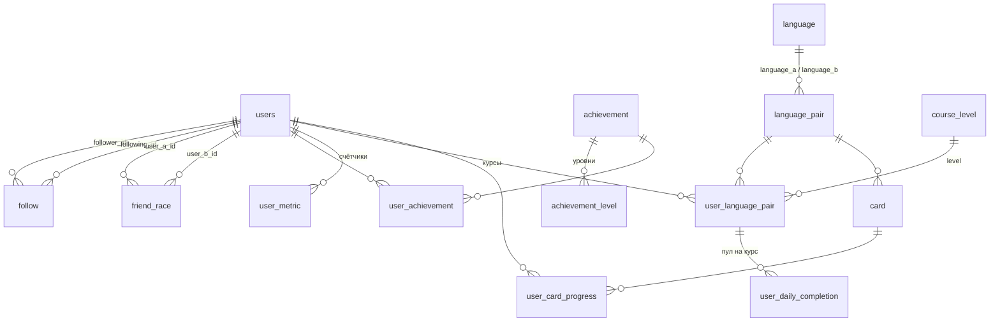

# База данных

Схема Postgres `swipy`. База создаётся с нуля. Миграция: [backend/migrations/000001_init.up.sql](../backend/migrations/000001_init.up.sql).
Документ описывает, какие таблицы и поля нужны для экрана профиля ([api/profile.md](api/profile.md)).

## Связи

Кратко:

- Пользователь подписывается на других пользователей (`follow`, связь «многие ко многим» на `users`).
- Дружеский забег связывает двух пользователей. Создать его можно, только если один подписан на другого (проверка в сервисе, не в БД).
- Для забега хранится время последнего выполнения задания каждым из двоих (`user_a_last_done`, `user_b_last_done`). Когда оба выполнили в один день, счётчик `friend_race.streak_days` увеличивается.
- Достижения: награда — семейство с уровнями (`achievement` и `achievement_level`), например «Группа поддержки» на 25, 40, … раз. У пользователя хранится достигнутый уровень (`user_achievement`), а счётчики для метрик — в `user_metric`. Правила выдачи лежат в данных: метрика и порог на уровень.
- Курс пользователя — `user_language_pair`. Изучаемый язык курса — `user_language_pair.learning_language_id`, а `language_pair` без направления.
- Карточка (`card`) принадлежит паре языков и хранит слово на обоих языках. Прогресс пользователя по карточке (`user_card_progress`) ведётся отдельно для каждого направления (`a_to_b` / `b_to_a`).

## Таблицы

### users

| Поле                  | Тип                                | Описание                                                                                                                                                         |
| --------------------- | ---------------------------------- | ---------------------------------------------------------------------------------------------------------------------------------------------------------------- |
| `id`                  | serial PK                          | ID пользователя                                                                                                                                                  |
| `provider`            | varchar(20)                        | `telegram`, `vk`, `internal` (см. [auth.md](api/auth.md))                                                                                                        |
| `external_id`         | bigint null                        | ID на платформе (`vk_user_id`, `user.id` Telegram). Для `provider = 'internal'` всегда `NULL`                                                                    |
| `first_name`          | varchar(100) null                  | Имя                                                                                                                                                              |
| `last_name`           | varchar(100) null                  | Фамилия                                                                                                                                                          |
| `language`            | varchar(10) null                   | Язык интерфейса                                                                                                                                                  |
| `username`            | varchar(50) not null, unique       | В API: `username`. При создании генерируется как `<имя доброго животного>_<id>` (например `otter_42`), см. `tools.GenerateUserName`                                |
| `points`              | int not null default 0             | Очки. Растут при прохождении ежедневного пула слов                                                                                                               |
| `streak_days`         | int not null default 0             | Дней подряд с пройденным ежедневным пулом                                                                                                                        |
| `timezone`            | varchar(50) not null default 'UTC' | Часовой пояс пользователя, IANA-название (`Europe/Moscow`). Если клиент не прислал или прислал неизвестное, остаётся `UTC` (это тоже IANA-название, смещение +0) |
| `last_completed_date` | timestamptz not null default now() | Начальное значение — момент создания; затем момент, когда пул пройден последний раз. Нужен, чтобы понять, продолжается ли streak или сброшен                     |

### Пользователи provider = 'internal'

Приложение в App Store: платформенного ID нет, поэтому `external_id = NULL`.

- `CHECK ((provider = 'internal') = (external_id IS NULL))`: у `telegram` и `vk` `external_id` обязателен, у `internal` его не бывает.
- `UNIQUE (provider, external_id)` остаётся, и для `telegram` и `vk` защищает от дублей. Для `internal` он ничего не проверяет: в Postgres `NULL` не равен `NULL`, и несколько строк с `external_id IS NULL` допустимы.
- Внутреннего пользователя определяет только `users.id`. Как он регистрируется и как сервер его узнаёт (токен, логин), в схему не входит, см. [auth.md](api/auth.md).

### Часовой пояс и граница дня

- Клиент присылает `timezone` при входе: `Intl.DateTimeFormat().resolvedOptions().timeZone`. Значение обновляется при каждом входе.
- Сервис проверяет название (`time.LoadLocation`). Если пояса нет или он неизвестен, используется `UTC`.
- Календарный день пользователя: `(now() AT TIME ZONE users.timezone)::date`. По нему определяются «сегодня» и «вчера» для серии (`streak_days`) и для забега.
- Для забега двух друзей день каждого участника считается по его собственному поясу.

### Сброс streak

Фоновой задачи нет, серии сбрасываются при чтении. Это ленивый сброс.

- **Серия пользователя.** При чтении пользователя, если день `last_completed_date` (по `users.timezone`) раньше вчерашнего, `users.streak_days` обнуляется (`UPDATE` в той же операции).
- **Забеги.** При чтении пользователя проверяются его забеги. Если у любого участника день `user_a_last_done` или `user_b_last_done` (по его поясу) раньше вчерашнего, `friend_race.streak_days` обнуляется.
- **При прохождении пула** проверка выполняется до начисления: если серия уже просрочена, она сначала обнуляется, и только потом прибавляется 1. Иначе просроченная серия, которую ещё не читали, продолжила бы расти.
- Вчерашний день пользователя: `(now() AT TIME ZONE users.timezone)::date - 1`.

### follow

Подписка: `follower_id` подписан на `following_id`.

| Поле           | Тип                                  | Описание            |
| -------------- | ------------------------------------ | ------------------- |
| `follower_id`  | int FK → users.id, on delete cascade | Кто подписался      |
| `following_id` | int FK → users.id, on delete cascade | На кого подписались |
| `created_at`   | timestamptz default now()            | Когда               |

- `PRIMARY KEY (follower_id, following_id)`, `CHECK (follower_id <> following_id)`.
- Индекс по `following_id` для подсчёта подписчиков.
- `stats.followers_count` = число строк с `following_id = me`, `stats.following_count` = число строк с `follower_id = me`.

### friend_race

Дружеский забег двух пользователей.

| Поле               | Тип                                  | Описание                                                                                          |
| ------------------ | ------------------------------------ | ------------------------------------------------------------------------------------------------- |
| `id`               | serial PK                            | ID забега                                                                                         |
| `user_a_id`        | int FK → users.id, on delete cascade | Участник с меньшим `id`                                                                           |
| `user_b_id`        | int FK → users.id, on delete cascade | Участник с большим `id`                                                                           |
| `streak_days`      | int not null default 0               | Общий streak: дней подряд, когда оба выполнили задание                                            |
| `user_a_last_done` | timestamptz not null default now()   | Когда `user_a_id` последний раз выполнил ежедневное задание. Начальное значение — момент создания |
| `user_b_last_done` | timestamptz not null default now()   | Когда `user_b_id` последний раз выполнил ежедневное задание. Начальное значение — момент создания |
| `created_at`       | timestamptz default now()            | Когда создан                                                                                      |

- `CHECK (user_a_id < user_b_id)` и `UNIQUE (user_a_id, user_b_id)`: между двумя пользователями только один забег, порядок не важен.
- Условие создания (один подписан на другого) проверяется в сервисе при создании забега.
- Streak: при прохождении пула пользователь ставит свой `*_last_done = now()`. Если после этого у обоих `*_last_done` приходятся на один календарный день, `streak_days += 1`. Чтобы не засчитать день дважды, прибавление делается только если прежний `*_last_done` этого пользователя был раньше текущего дня.
- Сброс: см. [Сброс streak](#сброс-streak).
- В профиле: забеги, где `me` равен `user_a_id` или `user_b_id`, максимум 5. Соперник — второй участник.

### achievement

Семейство наград (около 10 записей). Уровни внутри семейства — в `achievement_level`.

| Поле          | Тип                          | Описание                                                                                            |
| ------------- | ---------------------------- | --------------------------------------------------------------------------------------------------- |
| `id`          | serial PK                    | ID награды (в API: `achievements[].id`)                                                             |
| `metric`      | varchar(30) not null, unique | Что считаем: `support_count`, `mistakes_fixed`, `streak_days` и т. д. Список метрик задаётся в коде |
| `name`        | varchar(100) not null        | Название на английском, например «Support group»                                                    |
| `description` | varchar(500) not null        | Описание на английском с подстановкой порога, например «Congratulated friends {n} times»            |

`name` и `description` в API профиля пока не отдаются: клиент подставляет локализованный текст по `id`. Поэтому `id` должны быть стабильными.

### achievement_level

Уровни награды. Каждый следующий уровень требует больше, чем предыдущий (25, 40, …).

| Поле             | Тип                                        | Описание                          |
| ---------------- | ------------------------------------------ | --------------------------------- |
| `achievement_id` | int FK → achievement.id, on delete cascade | Награда                           |
| `level`          | int not null                               | 1, 2, 3, …                        |
| `threshold`      | int not null                               | Порог метрики для этого уровня    |
| `icon_url`       | varchar(500) not null                      | Иконка уровня (в API: `icon_url`) |

- `PRIMARY KEY (achievement_id, level)`.
- Пороги растут вместе с уровнем (проверка при заполнении справочника).

### user_achievement

Достигнутый уровень награды у пользователя. Одна строка на награду, уровень только растёт.

| Поле             | Тип                                        | Описание                                                                                 |
| ---------------- | ------------------------------------------ | ---------------------------------------------------------------------------------------- |
| `user_id`        | int FK → users.id, on delete cascade       | Пользователь                                                                             |
| `achievement_id` | int FK → achievement.id, on delete cascade | Награда                                                                                  |
| `level`          | int not null                               | Максимальный полученный уровень                                                          |
| `unlocked_at`    | timestamptz default now()                  | Когда получен последний уровень. Нужно для сортировки «новые первыми»; в API не отдаётся |

- `PRIMARY KEY (user_id, achievement_id)`.
- `is_locked` в API = нет строки в `user_achievement`. Если полученных меньше 4, недостающие места заполняются наградами, которых у пользователя нет (для них показывается иконка уровня 1). Для полученной награды `icon_url` берётся у её текущего уровня.

### user_metric

Счётчики пользователя для наград. Метрики, которые уже хранятся в `users` (`streak_days`, `points`), здесь не дублируются: сервис берёт их оттуда.

| Поле      | Тип                                  | Описание                                           |
| --------- | ------------------------------------ | -------------------------------------------------- |
| `user_id` | int FK → users.id, on delete cascade | Пользователь                                       |
| `metric`  | varchar(30) not null                 | Название метрики, совпадает с `achievement.metric` |
| `value`   | int not null default 0               | Текущее значение                                   |

`PRIMARY KEY (user_id, metric)`.

### Выдача наград

Сервис выдаёт награду в той же транзакции, где меняется метрика:

1. Увеличивает метрику (`UPDATE user_metric SET value = value + 1 ... RETURNING value`) или берёт новое значение из `users`.
2. Находит максимальный `level` награды с этой `metric`, у которого `threshold <= value`.
3. Если он выше текущего в `user_achievement` (или строки нет), записывает его через `INSERT ... ON CONFLICT (user_id, achievement_id) DO UPDATE SET level = EXCLUDED.level, unlocked_at = now() WHERE user_achievement.level < EXCLUDED.level`.

Если значение перескочило несколько порогов, берётся сразу максимальный подходящий уровень. Проверяются только награды изменившейся метрики. Повторная проверка безопасна.

Пример «Группа поддержки» (`support_count`): уровни 25 и 40. На 25-м поздравлении друга выдаётся уровень 1, на 40-м — уровень 2.

Сложные условия, которые не сводятся к «метрика достигла порога», выдаются в коде по `achievement.id`.

### user_daily_completion

Факт прохождения пула слов по курсу. Одна запись — один пройденный пул. Пулов в день можно проходить сколько угодно, по любому курсу. Записи дают историю и основу для начисления очков.

| Поле                    | Тип                                               | Описание                                                        |
| ----------------------- | ------------------------------------------------- | --------------------------------------------------------------- |
| `id`                    | serial PK                                         | ID прохождения                                                  |
| `user_language_pair_id` | int FK → user_language_pair.id, on delete cascade | Курс, по которому пройден пул. Пользователь определяется курсом |
| `day`                   | date                                              | День (по `users.timezone`)                                      |
| `cards_count`           | int not null                                      | Сколько карточек было в пуле                                    |
| `mistakes_count`        | int not null default 0                            | Сколько ошибок сделано за пул                                   |
| `points_earned` | int not null default 0 | Сколько очков начислено. Пока формулы нет, остаётся 0 |
| `completed_at`          | timestamptz default now()                         | Когда пройден пул                                               |

- Ограничения «один пул в день» нет. Индекс `(user_language_pair_id, day)` нужен для выборки пулов курса за день и для истории.
- База не защищает от накрутки: каждый пул должен быть выдан сервером, а `cards_count` и `mistakes_count` сервис считает сам по ответам, которые сохранил, а не берёт у клиента.
- Сейчас фиксируется только факт прохождения пула и число ошибок (`cards_count`, `mistakes_count`). Формула очков в проработке: когда она появится, `points_earned` будет считаться сервисом по этим значениям, а историю можно пересчитать.
- Серия (`users.streak_days`) и забеги общие для пользователя: день считается выполненным, если пройден **хотя бы один** пул по любому курсу.
- Прохождение пула в одной транзакции:
  1. вставка записи;
  2. `user_language_pair.points += points_earned` и пересчёт `level`;
  3. `users.points += points_earned`;
  4. если это первый пул пользователя за сегодняшний день (по `users.timezone`): обновление `users.last_completed_date` и `users.streak_days`, обновление `user_a_last_done` / `user_b_last_done` во всех забегах пользователя и пересчёт `friend_race.streak_days`. Если сегодня уже был пройден другой пул, шаг 4 пропускается, серия второй раз не растёт.

### Ежедневный пул

Пул формируется отдельно для каждого курса (`user_language_pair`) и состоит из двух частей:

- **Новые слова:** карточки пары курса, по которым у пользователя ещё нет прогресса (или `status = 'new'`).
- **Повторяющиеся слова:** карточки, которые пользователь уже изучал (есть строка прогресса). Чем больше `correct_streak`, тем реже карточка попадает в пул.

Для выбора повторяющихся слов используются поля `user_card_progress.correct_streak` и `last_studied_at`. Сколько карточек в пуле, каково соотношение новых и повторяющихся и по какому правилу растёт интервал между показами, ещё не определено, см. «Открытые вопросы».

### language

| Поле   | Тип                | Описание                                          |
| ------ | ------------------ | ------------------------------------------------- |
| `id`   | serial PK          | ID языка                                          |
| `name` | varchar(100)       | Название (в API: `courses[].language.name`)       |
| `icon` | varchar(100)       | Иконка или флаг (в API: `icon`)                   |
| `code` | varchar(10) unique | Код языка, например `en` (в API: `language.code`) |

### language_pair

Пара языков **без направления**. Для английского и русского существует одна запись, и её карточки используют и англичанин, который учит русский, и русский, который учит английский. Направление изучения хранится в курсе пользователя (`user_language_pair`).

| Поле            | Тип                            | Описание            |
| --------------- | ------------------------------ | ------------------- |
| `id`            | serial PK                      | ID пары             |
| `language_a_id` | int FK → language.id, not null | Язык с меньшим `id` |
| `language_b_id` | int FK → language.id, not null | Язык с большим `id` |

- `CHECK (language_a_id < language_b_id)` и `UNIQUE (language_a_id, language_b_id)`: между двумя языками только одна пара, порядок не важен. Сервис при создании сам ставит меньший `id` в `language_a_id`.

### user_language_pair

Курс пользователя. Здесь хранится направление: какой язык пользователь учит, а какой уже знает.

| Поле                   | Тип                                             | Описание                                                                                                                                                     |
| ---------------------- | ----------------------------------------------- | ------------------------------------------------------------------------------------------------------------------------------------------------------------ |
| `id`                   | serial PK                                       | ID курса (в API: `courses[].id`)                                                                                                                             |
| `user_id`              | int FK → users.id                               | Пользователь                                                                                                                                                 |
| `language_pair_id`     | int FK → language_pair.id                       | Пара языков                                                                                                                                                  |
| `learning_language_id` | int FK → language.id, not null                  | Изучаемый язык (в API: `courses[].language`). Должен быть `language_a_id` или `language_b_id` пары (проверка в сервисе). Второй язык пары пользователь знает |
| `created_at`           | timestamptz default now()                       | Когда добавлен                                                                                                                                               |
| `points`               | int not null default 0                          | Очки, набранные в этом курсе                                                                                                                                 |
| `level`                | int FK → course_level.level, not null default 1 | Уровень в курсе (в API: `courses[].level`). Определяется `points`                                                                                            |

- Уровень растёт, когда `points` курса достигают порога следующего уровня. Очки за пул начисляются в курс, по которому пройден пул (и в общие `users.points`).
- `level` хранится и пересчитывается в той же транзакции, что и `points`: по уровню курса профиль читается чаще, чем пул проходится.
- Пороги очков по уровням лежат в таблице `course_level`. Новый уровень курса: максимальный `course_level.level`, у которого `points_required <= user_language_pair.points`.

`UNIQUE (user_id, language_pair_id)`.

### course_level

Справочник уровней курса: сколько очков нужно для каждого уровня. Один для всех курсов.

| Поле              | Тип                  | Описание                                      |
| ----------------- | -------------------- | --------------------------------------------- |
| `level`           | int PK               | Номер уровня: 1, 2, 3, …                      |
| `points_required` | int not null, unique | Сколько очков по курсу нужно для этого уровня |

- Уровень 1 стартовый: `points_required = 0`, у каждого курса он есть с создания.
- `points_required` растёт вместе с `level` (проверка при заполнении справочника).
- Значения заполняются миграцией или сидом. Конкретные пороги пока не определены.

### card

Карточка пары языков. Одна запись обслуживает оба направления.

| Поле               | Тип                                          | Описание                      |
| ------------------ | -------------------------------------------- | ----------------------------- |
| `id`               | serial PK                                    | ID карточки                   |
| `language_pair_id` | int FK → language_pair.id, on delete cascade | Пара                          |
| `text_a`           | varchar(255) not null                        | Слово на `language_a_id` пары |
| `text_b`           | varchar(255) not null                        | Слово на `language_b_id` пары |
| `transcription`    | varchar(255) null                            | Транскрипция                  |
| `image_url`        | varchar(500) null                            | Картинка                      |
| `audio_url`        | varchar(500) null                            | Аудио                         |
| `created_at`       | timestamptz default now()                    | Когда создана                 |

Лицевой стороны у карточки нет: что показывать как вопрос, определяет `direction` в прогрессе.

### user_card_progress

Статус карточки у пользователя. Прогресс ведётся отдельно по каждому направлению.

| Поле              | Тип                                  | Описание                                                                                                                                                        |
| ----------------- | ------------------------------------ | --------------------------------------------------------------------------------------------------------------------------------------------------------------- |
| `id`              | serial PK                            | ID записи                                                                                                                                                       |
| `user_id`         | int FK → users.id, on delete cascade | Пользователь                                                                                                                                                    |
| `card_id`         | int FK → card.id, on delete cascade  | Карточка                                                                                                                                                        |
| `direction`       | varchar(10) not null                 | `a_to_b`: вопрос `text_a`, ответ `text_b`. `b_to_a`: наоборот                                                                                                   |
| `status`          | varchar(20) not null default 'new'   | `new`, `learning`, `learned`                                                                                                                                    |
| `correct_streak`  | int not null default 0               | Счёт знания карточки в этом направлении. Растёт на 1 за каждый правильный ответ, при ошибке уменьшается на 1 (не ниже 0). От него зависят `learned` и частота показа |
| `last_studied_at` | timestamptz null                     | Когда карточка изучалась в последний раз. `NULL`, пока ни разу                                                                                                  |
| `updated_at`      | timestamptz default now()            | Когда обновлено                                                                                                                                                 |

- `UNIQUE (user_id, card_id, direction)`, `CHECK (direction IN ('a_to_b', 'b_to_a'))`.
- `status`: `new` до первого изучения, затем `learning`, и `learned`, когда `correct_streak` достигает порога (предлагается 5, значение задаётся в коде). После порога счёт продолжает расти.
- Чем больше `correct_streak`, тем реже карточка попадает в пул (например, при 10 в N раз реже). Правило частоты по `correct_streak` и `last_studied_at` ещё не определено, см. [Ежедневный пул](#ежедневный-пул).
- Основное направление курса: вопрос на известном языке, ответ на изучаемом (`user_language_pair.learning_language_id`). Если изучаемый язык — `language_b_id`, это `a_to_b`, иначе `b_to_a`. Обратное направление включается как режим, и у него свой прогресс: слово можно знать при узнавании и не помнить при вспоминании.

### Пример

Пара en/ru: `language_a_id = en`, `language_b_id = ru` (если `en.id < ru.id`). Карточка `text_a = apple`, `text_b = яблоко`.

- Англичанин, который учит русский: курс с `learning_language_id = ru`. Видит «apple», отвечает «яблоко» (`a_to_b`).
- Русский, который учит английский: курс с `learning_language_id = en`. Видит «яблоко», отвечает «apple» (`b_to_a`).
- Одна карточка, прогресс у каждого свой.

## Откуда берутся поля профиля

| Поле API                                              | Источник                                                                                                                            |
| ----------------------------------------------------- | ----------------------------------------------------------------------------------------------------------------------------------- |
| `id`, `first_name`, `last_name`, `username`, `points` | `users`                                                                                                                             |
| `stats.streak_days`                                   | `users.streak_days`                                                                                                                 |
| `stats.followers_count`, `stats.following_count`      | подсчёт по `follow`                                                                                                                 |
| `courses[]`                                           | `user_language_pair` → `language` (изучаемый язык `learning_language_id`)                                                           |
| `friend_races[]`                                      | `friend_race` (≤ 5) + `users` для соперника; `streak_days` из `friend_race.streak_days`                                             |
| `achievements[]`                                      | `achievement` + `achievement_level` + `user_achievement`; `is_locked` — нет записи в `user_achievement`; `icon_url` — иконка уровня |

## Открытые вопросы

1. **Пороги уровней.** Сколько всего уровней и сколько очков нужно для каждого (значения для `course_level`)?
2. **Ежедневный пул слов.** Размер пула и соотношение новых и повторяющихся слов. Правило частоты повторения: как интервал между показами зависит от `correct_streak` (например, после 10 повторов карточка в N раз реже). Фиксируется ли набор на день (отдельные таблицы пула) или собирается при каждом запросе.
3. **Формула очков.** Как считать `points_earned` по `cards_count` и `mistakes_count`. Пока считается только факт прохождения пула и число ошибок.
